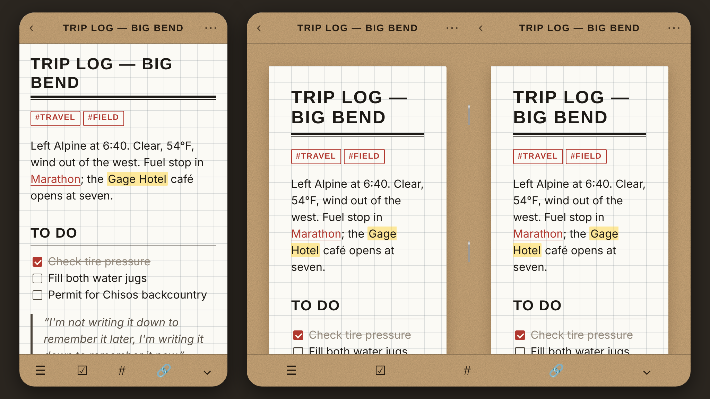

# Field Notes — an Obsidian theme

A pocket-notebook theme for Obsidian: kraft cover stock, graph-ruled pages, all-caps geometric headings and black "ink" text. It's built for iPhone first, including a foldable iPhone's folded and unfolded screens.

## Layouts

| Screen | What you get |
| --- | --- |
| **Folded / regular iPhone** (narrow) | A full-bleed graph page under a kraft header band, a kraft mobile toolbar, and thumb-friendly margins and checkboxes. |
| **Unfolded / iPad** (600 px wide or more) | The page becomes a sheet lying on the open cover, with a comfortable reading width. |
| **Side-by-side panes** | When Obsidian allows splits (tablet layout), panes become facing pages with a shaded spine and two staples between them. |
| **Foldables that report a hinge** | Where the browser exposes the Viewport Segments API, a spine shadow is drawn on the fold. |

Dark mode is a "night edition": charcoal pages with a faint grid and a darkened cover.

## Details

- **Headings** are uppercase Futura with a double rule under the note title.
- **Tags** look rubber-stamped: an outlined box in uppercase.
- **Checkboxes** are square, pencil-boxed and filled with ink when checked.
- **Horizontal rules** are perforation lines.
- **Tables** are ledger-ruled.
- **Callouts** look like slips of paper clipped to the page.
- **Highlights** look like a highlighter swipe.

## Install

1. In your vault, create the folder `.obsidian/themes/Field Notes/`. The folder name must match the theme name exactly.
2. Copy `manifest.json` and `theme.css` into that folder.
   - On iPhone, use the Files app. With an iCloud vault the path is *iCloud Drive → Obsidian → your vault → .obsidian → themes*. To see `.obsidian`, show hidden files, or copy the files from a Mac.
3. In Obsidian, go to **Settings → Appearance → Themes** and choose **Field Notes**.

## Options

Install the community plugin **Style Settings** to change these options:

- **Page ruling:** graph (default), ruled, dot grid or blank.
- **Grid size:** 16–36 px. The default of 24 px matches 16 px text at 1.5 line height, so text sits on the lines.
- **Cover stock:** kraft (default), black, olive drab, blue chambray or fire red.
- **Ink colour:** rubber-stamp red (default), ballpoint blue, surveyor green or graphite.
- **Body typeface:** geometric sans (Avenir Next), all Futura, or typewriter (American Typewriter).
- **Sheet-on-cover layout:** switch it off for wide screens, or turn it on for desktop too.
- **Staples and cover texture:** each can be hidden.

## Fonts

The theme uses fonts that ship with iOS, iPadOS and macOS: **Futura**, **Avenir Next** and **American Typewriter**. No font files are bundled. On Windows, Linux or Android it falls back to **Jost**, **Century Gothic** or **Courier Prime** if you have them installed, and to a system sans-serif otherwise.

## Notes

- The wide layout starts at a 600 px viewport width, so it doesn't depend on any particular device's screen size. If a foldable reports a different width when unfolded, the layout still follows the actual width.
- `screenshot.png` (512×288) is the thumbnail the community theme gallery expects.

*Field Notes Brand did not make or endorse this theme. It's a fan-made homage to their pocket notebooks. If you submit it to the community theme directory, consider renaming it to avoid using their trademark.*
